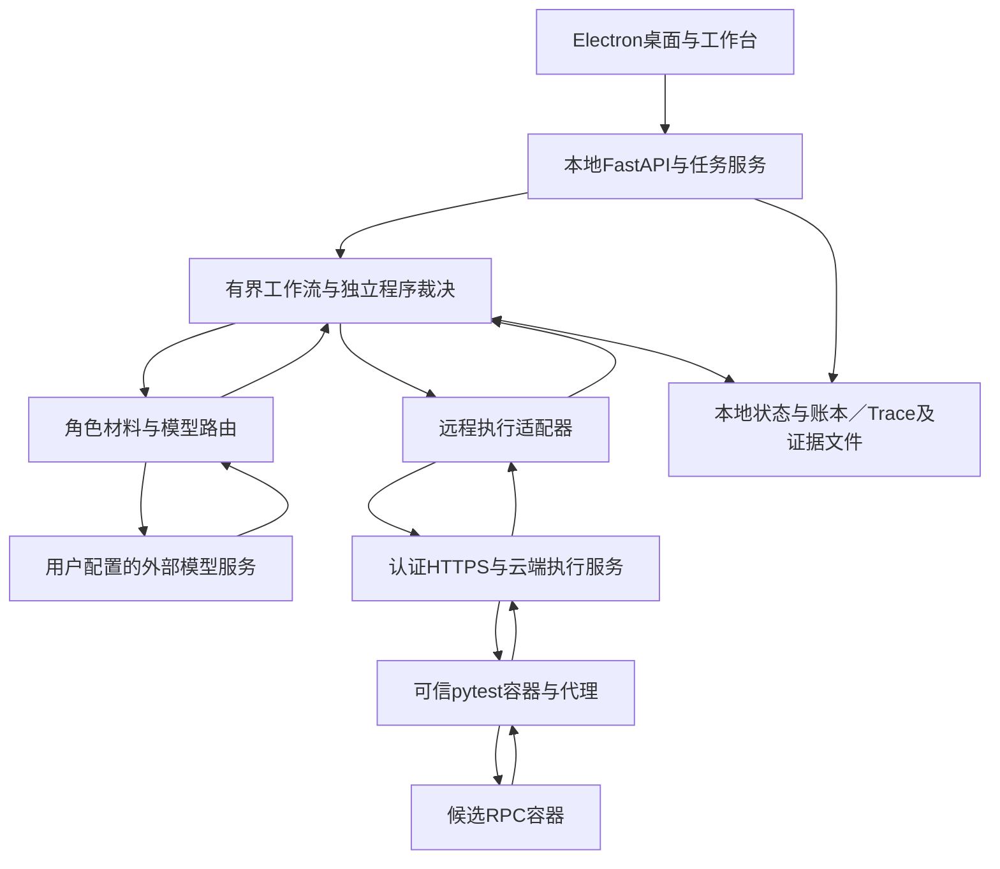

# 验链 Code Fix：Codex C/D 赛事答辩 PPT 完整制作总提示词

用途：将本文件完整交给 Codex，按“C：技术与证据审校 → D：内容、设计与制作 → C：复核 → D：修订”的顺序执行；也可在两个制作对话中共用本文件。交付一套 PPT 和一套一致的讲稿，不拆成两份互不相干的提示词。本文件自身是制作任务书；本次修订只完善任务书，不代表已制作、渲染或验收正式 PPT。

证据截止：2026-11-12；提示词整理：2026-11-13。暂按 **8分钟、12页主稿、答辩备份页** 设计。官方讲解时间、页数与评分细则尚未发布，发布后调整节奏与页数，不更改事实。

---

## 直接执行的任务

你们分别担任资深软件工程研究者、Agent 系统架构师、竞赛答辩内容策划和技术演示设计师。请共同为“验链 Code Fix——证据驱动的多 Agent 编排与验证平台”制作中文赛事答辩 PPT。

Codex以C模式负责：源码和原件核对、技术架构、数据口径、可支持的创新主张、旧图复用清单、技术审校。Codex以D模式负责：评委视角的研究叙事、逐页文案、讲稿、视觉设计、可编辑PPTX制作与渲染修订。两种模式共用同一事实底稿；同一个Codex可依次执行，不要求自动创建新对话或子代理。这里的C/D是本次制作职责，不改变原项目成员身份；Codex审校不能代替项目成员C本人独立复跑和签收。

目标是让评委在8分钟内理解：**平台如何让多个职责不同的 Agent，依据真实测试证据决定下一步，并形成可核验的修复闭环。** 既要有技术说服力，也要有面向用户的产品呈现。请从项目实际机制出发建立辨识度。

最终制作一套论证完整、图示准确、语言清晰、可编辑、可离线播放的技术答辩稿。主稿面向评委与老师，深入细节放备注和备份页。不要把开发日报、返修编号、Git合并过程或安装排障过程当主线。

本轮先依据下述材料完成内容和设计。缺少的截图、视频和新实验列入具体补件清单，同时继续完成其余页面。不要反复停在“请提供更多资料”。不得为了制作PPT启动付费修复、改测试、安装未知依赖或改变平台功能。

## 一、比赛要求与主张

### 1. 可核实的赛道要求

用户提供的官方截图标题为“赛道一：Agent编排创新应用”。主题为“大模型Agent工具编排调度平台”，要求设计实现面向多智能体协作的编排、调度、执行与验证平台；参考 LobeHub、DeepSeek Harness 等 Agent Harness 框架；考察知识库定义与集成、Agent团队定义、工作流编排、动态调度、自我循环（Self-Loop）、结果验证与反馈优化等全链路工程化能力。要求围绕真实或模拟复杂任务场景构建可运行平台，形成技术方案与演示成果。

截图没有给出评分百分比、必须采用的框架、演讲限时、正式页数要求。导师文档是指导意见，不冒充官方评分表。不要声称已集成、超越或全面替代截图提及的框架。

### 2. 建议题目与一句话定位

主标题：**验链 Code Fix**

副标题：**证据驱动的多 Agent 编排与验证平台**

封面短句：**让测试证据决定下一步。**

口头定位：以 Python 缺陷修复为验证场景，贯通多角色协作、证据调度、隔离执行和干净复验，回答“下一步做什么、为什么这样做、结果如何核验”。

复杂性来自跨角色、跨执行边界、失败反馈、预算与版本一致性的协调。当前基准中的程序本身较小，不夸大为大型企业代码库自动修复。

### 3. 评委视角下需要回答的问题

以下为本次内容策划判断，不是官方评分权重：

| 评委会关心什么 | 本项目应展示的回答 | 最有说服力的材料 |
| --- | --- | --- |
| 为什么需要编排，而不只调用一次模型？ | 测试失败后要区分重修、重新定位、环境阻断和人工处理 | 实际失败分类、规则与分支 |
| 多 Agent 是否只是重复调用？ | 角色有不同输入、输出、权限；按证据选择参与者 | 角色输入输出表、实际调用链 |
| 谁最终决定下一步？ | 模型提出建议，独立程序层核验并裁决 | wrap 的 repair 建议被 R13 改为 locate |
| 所谓成功是否真实？ | 开发测试通过后还要在干净副本复跑冻结原生测试 | 开发与final的JUnit、版本和计数 |
| 能否运行并交给用户？ | 桌面应用让用户配置自己的模型与云端执行连接 | 实际界面、配置检查、结果对比 |
| 效果与代价如何？ | 报告完整样本分母、失败、请求、费用及版本，以及消融对比 | 消融25→34→40三阶段、冻结批次结果、逐题清单 |
| 失败时系统怎样收敛？ | 有界重试、原因记录、停止自动流转并生成移交包 | 真实历史上限停止与pending_human |
| 研究结论是否站得住？ | 区分机制成立、案例成功与策略优越性 | 等资源对照设计、已知局限 |

## 二、七个对话与两份指导材料的蒸馏

### 1. 来源范围

已经检索到本机与 Code Fix 工作目录关联的7个正式对话记录。可恢复的对话内容、当前长对话、固定台账、源码与原始运行证据联合用于本提示词。会话入口不等于完整正文，不能声称七个对话的每条内容都已完整恢复。

| 对话 | 可读范围 | 对PPT有用的蒸馏 |
| --- | --- | --- |
| “将资料库中的验链项目范围说明导入到这个项目中作为scope.md” | 有正文；早期范围、导师材料、候选版与协作讨论 | 从单次演示发展为可运行平台；区分材料、组件和真实能力；以编排创新为主线 |
| 以“你现在是一名资深的Python后端工程师、Agent系统架构师…”开头 | 有正文；后端核验、角色、调度、费用、可信执行与工作台讨论 | 真实工具证据、建议与裁决分离、权限边界、清晰的工作台和配置入口 |
| “继续”，会话ID以01a19d25开头 | 本地只有会话元数据/事件，没有可恢复的消息正文 | 不补造其内容，不计作独立的功能或验收证据 |
| “继续”，会话ID以01a19d26开头 | 同上 | 同上 |
| “现在让B交什么c跑什么” | 有正文；执行机与独立复核交接 | B交实现与原件，C对准确版本本人复跑；隔离资格、模型修复、独立签收分别登记 |
| 以“问题1—service.py…except Exception…”开头的当前长对话 | 有正文；复核、40题、桌面化、云端、重试、计价及最新成功案例 | 产品使用路径、输出有效性、结构化失败、真实闭环和测试版本绑定 |
| 以“这一张还可以，但是关于线…”为请求的对话 | 可读到用户反馈和图片引用，没有后续有效答复 | 连线必须解释真实关系；不把概念图当实际Trace；重视视觉中心和边界 |

早期讨论中的“双硅基账号、仅三题、尚无闭环、坏JSON一律停止、只能本机执行”等说法属于历史阶段，不用来覆盖当前产品。以同版本原始证据确定当前结论。

### 2. 导师两份DOCX的采用方式

参考材料为《参赛注意点》和《研究报告大纲》。采用其关于角色解耦、结构化消息、原生测试、有限重试、公开样本、完整日志、失败分类、成本权衡与人工出口的建议。

与已确认方案不同的内容，按下列当前设计表述：

| 指导文档中的建议 | 当前采用的方案 | 解释 |
| --- | --- | --- |
| 定位、修复、测试三个Agent | 修复、检测、模型调度建议、定位四个模型角色，测试是确定性工具 | 按输入输出与权限定义角色，不把pytest拟人化为会判断正确性的LLM |
| 固定组一轮，动态组多轮 | 两组资源上限相同，策略不同，实际消耗分别统计 | 避免把更多尝试次数误当作编排优势 |
| 两套独立编排流 | 共用执行引擎与强制保护，独立策略配置、run和工作区 | 降低两套执行器造成的混杂因素 |
| 调度不采用LLM建议 | 保留LLM建议，最终动作由程序裁决 | 实际建议、规则裁决、采用动作及覆盖原因分列 |
| 本地轻量脚本执行 | 用户端连接云端Linux Docker隔离服务 | 支持无本机Docker的用户，候选执行与测试取证分离 |
| 推荐重试2次 | 当前典型限制最多3次修复尝试 | 首次尝试计入；最多两次后续尝试，不表示必须跑满三轮 |

不把“多数现有方案都是固定流程”作为无文献依据的普遍事实。请用本项目要解决的具体问题开场。

## 三、项目真实功能与技术实现

### 1. 用户看见的使用过程

打开桌面应用 → 填入个人API地址、API Key和模型 → 查询可用模型/测试调用 → 填入执行服务地址与访问码 → 自动检查连接、隔离及其他前置条件 → 保存配置 → 选择题目、策略和上限 → 创建并启动任务 → 查看实际节点、决策及证据 → 查看代码差异、测试对比、费用和报告下载。

普通用户的正常连接方式是HTTPS直连云端执行服务，不要求每位用户安装Docker或使用SSH。服务部署是管理员的一次性工作；新电脑仍需有效模型凭据、访问码、网络和可用额度，不能宣传为完全零配置。

产品不内置团队的模型账号或密钥。密钥不得出现在PPT、截图、视频、证据预览和交付源文件中。展示模型选择、配置能力时使用真实界面或明确标为设计示意的图。

### 2. 技术组成：必须解释它们解决什么问题

| 层 | 技术/实现 | 解决的问题 | PPT表达方式 |
| --- | --- | --- | --- |
| 桌面入口 | Electron，打包Python后端 | 用户打开应用、保存个人连接设置 | 终端用户图标＋应用截图 |
| 服务接口 | Python、FastAPI/Uvicorn | 创建、启动、查询、控制任务及下载证据 | 用户请求到运行服务的一条清晰路径 |
| 编排控制 | 工作流状态机、规则裁决、角色网关 | 证据选择动作、控制循环、绑定实际执行 | 主流程与橙色重试分支 |
| 状态与账本 | SQLite、运行事件、调用和费用记录 | 刷新恢复查看、次数/费用累计、避免重复启动 | 证据与账本侧轨 |
| 模型连接 | 兼容HTTP接口、个人模型档案与角色绑定 | 多角色可同模型或不同模型，参数受能力校验 | 模型作为外部服务，不能画在候选容器内 |
| 隔离执行 | Linux Docker、候选/可信测试分离、受限RPC | 执行候选，同时保护测试与真实取证路径 | 云端双容器及信任边界 |
| 测试核验 | pytest、JUnit、结构化生命周期报告、退出码和版本核对 | 区分执行结束、测试通过和证据完整 | 真实测试证据卡 |
| 工作台 | HTML/CSS/JavaScript/SVG | 实际链路、节点详情、日志、diff、费用与历史回放 | 一张主截图配两处放大 |
| 任务与知识 | QuixBugs登记资产、白名单Markdown知识及带引用检索 | 限定可修改范围，提供相关任务规则和上下文 | 角色输入旁的知识引用 |

已有知识检索按匹配词覆盖数优先、同覆盖数再比较总频次，返回带来源引用的片段。不声称已实现向量数据库、训练检索模型或语义RAG。当前支持单个允许修改源文件；可用完整源码或精确小补丁。长文件使用有界AST相关上下文，并不等于已经支持任意多文件仓库。

### 3. Agent团队

| 角色 | 输入 | 产出 | 权限边界 |
| --- | --- | --- | --- |
| 修复员repairer | 当前源码、任务契约、有效开发证据、定位与批准知识 | 结构化修改、说明，可采用单文件精确编辑 | 不能修改测试、执行任意命令或宣布成功 |
| 检测员detector | 当前候选对应的真实测试结果 | 与工具结果一致的失败分析和引用 | 不能制造或覆盖测试结论 |
| 模型调度员scheduler | 有效分析、证据、允许动作 | 下一步动作建议及理由 | 不能放行预算/权限，不能批准成功 |
| 定位员locator | 需要重新定位时的失败证据与源码上下文 | 可疑位置、假设和引用 | 分支需要时才参与；不是每轮固定调用 |
| pytest执行器 | 冻结测试、受控候选调用与限制 | 原始日志、JUnit、标准化证据 | 是工具组件，不是第五个LLM |
| 独立程序调度层 | 工具结论、版本、规则、限制、用户控制和模型建议 | 实际动作、目标角色、覆盖原因或终态 | 承担最终执行裁决，不依赖模型自报通过 |

同一模型可以扮演多个角色；实际请求次数不等于角色数，也不等于候选轮数。独立干净复验是程序测试阶段，不等于C本人独立验收。

### 4. 当前执行链

1. 检查配置、预算/权限及执行条件；远程隔离探针返回真实结果。
2. 对原始登记坏代码跑基线。预期断言失败表示缺陷复现成功，不显示为平台修复失败。
3. 修复员生成结构化修改；程序验证协议、路径、允许修改范围和补丁。
4. 应用有效候选，执行真实隔离开发测试。
5. 候选通过：直接进入干净副本最终复验，记录跳过非必需检测与建议的原因。
6. 候选失败：固定/动态策略按其规定流转；模型建议与程序最终裁决分别留证。
7. 允许的断言、语法、候选运行错误在剩余轮次/调用/时间/费用内继续；鉴权、隔离/环境、越权、未知费用、用户停止等不盲目重试。
8. final通过且版本/证据一致才宣告成功；final失败结束本次运行，不把final结果回传给同次Agent继续凑成功。
9. 失败或达到上限时保存停止原因和handoff.json，标记待人工处理。新模型/配置需由用户确认并创建新任务，不自动切换服务商继续花费。

修复员无效输出计一次修复尝试，不写入候选文件；检测员、调度员和定位员各有有界格式纠正。定位仍失败可记录失败并携带已有有效证据回修复；不能把鉴权、隔离、权限或未知费用异常吞成普通定位失败。

### 5. 固定与动态的区别

| 情形 | 固定策略fixed | 动态策略dynamic |
| --- | --- | --- |
| 普通失败轮 | 修复→测试→检测→建议记录，再按固定路线下一轮 | 依据失败证据决定需要哪些角色 |
| 语法错误 | 按固定失败分析顺序 | 可直接回修复，跳过非必需分析 |
| 断言失败 | 分析后重修，不动态追加定位 | 规则可要求定位后重修 |
| 开发通过 | 干净最终复验 | 同左 |
| 预算、隔离、版本、权限、用户控制 | 共同强制保护；接受保守pause/stop | 同左 |

两组共用执行和验收基础，旧API默认dynamic。保存配置时策略属于不可变快照，显式冲突需拒绝。不能把固定组画成“故意不给重试、不给final”的弱对照。

### 6. 可配置与可追溯

角色任务指令可独立编辑，每角色最多4000字符；固定系统协议、权限和测试规则只读。输出长度、temperature、top_p以及特定模型的思考控制按已核实能力开放，未经支持的参数不能显示“已应用”。同模型绑定不同角色时参数分别生效。

当前已核实个人服务特定模型可发送思考控制；不能概括为所有模型都支持。连续出现全部输出额度用于思考且正文为空时，不原样无限重试；明确诊断并有界停止/移交。

配置流程为草稿→校验→有效值预览→保存不可变配置→新任务。价格也保存版本快照，运行之后改配置不改历史请求。

### 7. 证据可信性与执行边界

候选容器运行不可信修改，不直接接触测试文件；可信pytest容器经受限RPC调用候选并产生报告。根据登记协议处理JSON、元组/集合/特殊字典键及图/链表身份等，不能用pickle传任意对象。当前有针对登记项目的defaultdict返回兼容。

执行采用无网络、只读、非root、权限收缩、CPU/内存/进程/时限等约束，结合镜像、源码、测试版本和清理结果记录。目标是隔离执行与保护取证，不声称Docker绝对安全或形式化证明不可逃逸。

最终复验从干净起点应用冻结候选，跑同套原生测试。它能证明本套登记测试通过；不等于隐藏测试、全面语义正确或测试覆盖完备。

### 8. 消融实验：25→34→40 完整数据

以下为同模型、同40题三阶段逐题结果对照。这是回答"编排贡献了什么"的核心证据。

#### 阶段一：单次修复基线（25/40）

仅调用修复员一次，无检测反馈、无定位员、无调度裁决、无重试、无final复验。直接跑修复后的开发测试即视为最终结果。

| 指标 | 值 |
| --- | --- |
| 模型 | deepseek-v4.1-flash-1017 |
| 题目 | QuixBugs Python 40题 |
| 通过 | 25 |
| 未通过 | 15 |
| 通过率 | 25/40 = 62.5% |
| 请求数 | 40（每题一次修复调用） |
| 说明 | 无编排反馈的纯模型修复上限 |

#### 阶段二：编排反馈（34/40）

引入完整编排：检测员/定位员/模型调度建议、R13等程序裁决规则、有界重试（最多3轮）、开发测试后干净final复验。对应冻结100批次结果。

| 指标 | 值 |
| --- | --- |
| 通过 | 34 |
| 停止 | 4 |
| 阻断 | 2 |
| 通过率 | 34/40 = 85% |
| 实际请求 | 63 |
| 估算费用 | 人民币0.797610元 |
| 编排增益 | +9题（相对阶段一） |

#### 阶段三：完整编排＋执行修复（40/40）

在阶段二编排能力基础上，修复执行边界问题（RPC类型兼容、输出格式处理、候选容器与测试交互等），不做编排策略改动。

| 指标 | 值 |
| --- | --- |
| 通过 | 40 |
| 通过率 | 40/40 = 100% |
| 说明 | 编排策略未变，修复的是执行/协议层面的技术问题 |
| 执行修复贡献 | +6题（相对阶段二） |

#### 消融结论与PPT使用

- 三阶段使用一份统一的消融展示页（建议第10页或新的消融证据页），保留阶段、条件、通过数和归因。
- **25→34 由编排机制解释**：检测反馈、定位纠正、R13裁决、有界重试、final复验。
- **34→40 由执行边界修复解释**：不是编排更聪明了，是运行通路更可靠了。
- 不要把 25→40 全部归为编排功劳，也不要把 40/40 说成"编排成熟后的最终成绩"来覆盖 34/40 的批次历史。
- 如果当前有了同版本冻结的 40/40 完整批次，可以替换原冻结100批次（34/40）作为"当前完整结果"，但同时保留阶段一和阶段二作为消融对照，不要删除历史数据。

### 9. 结果与费用（原第8节，编号后移）

结果可显示基线/各轮/最终测试对比、原代码与候选差异、请求数、费用状态、原因和下载。候选可在失败时查看，不把候选存在标成修复成功。原始记录缺少的数量必须显示未记录。

逐模型价格保存币种、单位、输入/输出/适用缓存价格、阶梯、来源及版本。使用usage估算，请求前预留，未知费用不当零；思考token不重复累计。人民币按人民币展示，不能把旧美元价格直接套给个人模型。

本批真实模型为个人接入服务上的deepseek-v4.1-flash-1017，不是“所有实验均使用阿里云官方千问API”。服务商、模型家族与模型ID分别标注。价格估算不是账单实扣。主页面最多呈现关键费用；价格全表、账本和模型能力放附录。


### 9. 技术栈必须讲到“怎样实现”，不要只放框架Logo

以下为已核对源码中的实现位置。主稿第3、4、11页选择最相关的4～6项解释，其余进技术备份页和备注。版本来自当前锁定文件，只说明本次实现环境；制作前若文件变化应重新核实，不能宣称支持所有版本。

| 技术环节 | 实际技术与源码入口 | 怎样实现 | 对用户/评委的价值与准确边界 |
| --- | --- | --- | --- |
| 桌面壳与打包 | Electron 45.2.3、electron-builder 26.18.0；`desktop/package.json`、`desktop/main.cjs` | 桌面主进程启动随应用交付的Python与后端，渲染本地界面；Windows x64输出NSIS安装版和免安装版 | 不要求老师先装Python；两种分发形态共用核心能力，不是两个平台 |
| 桌面与本地服务连接 | `desktop/preload.cjs`、`app/desktop_bootstrap.py` | 受限IPC连接设置页和主进程；后端监听本机回环地址，桌面等待本地服务可用 | 配置入口与业务运行分工清楚；不把Electron主进程画成云端任务执行器 |
| 个人配置与凭据 | Electron safeStorage；`desktop/settings.cjs`、`app/local_credentials.py`、`app/personal.py` | 在用户机器保存个人连接配置，凭据保护由本机机制承担；使用自带API账户，查询模型、检查连接 | 应用交给不同人使用时不内置团队密钥；不宣传为跨所有操作系统的绝对安全存储 |
| HTTP服务 | Python 3.14、FastAPI 0.162.0、Uvicorn 0.54.0；`requirements-lock.txt`、`app/api.py` | HTTP接口接收任务/配置，返回状态、事件、结果与证据下载 | 界面与编排分层、便于测试；FastAPI不是Agent调度算法 |
| 输入与配置校验 | Pydantic 2.14.2及项目校验；`app/configuration.py`、`app/role_overrides.py` | 草稿校验、有效配置预览、不可变保存；角色指令/参数进入快照 | 页面值能追到请求；未经核实或不支持的参数禁用，不声称所有模型都支持temperature/top_p/思考控制 |
| 角色与模型绑定 | `app/agents_v3.py`、`app/role_config.py`、`app/model_profiles.py`中的ModelRouter | 按角色构造不同任务材料和输出协议，选择相应模型档案与能力 | 多角色可以共用模型或独立绑定；不是必须购买四种模型，也不是四个常驻自治进程 |
| 模型HTTP请求 | HTTPX 0.28.1；`app/live_model.py` | 发出兼容HTTP请求，记录实际发送参数、用量、响应诊断、请求期限及结算 | 可接入符合协议的服务；角色调用尝试和已发出的HTTP请求分开统计 |
| 编排与状态机 | `app/workflow_v3.py`、`app/decision.py` | 有界循环和显式阶段；证据、规则、限制、用户控制共同决定实际动作；固定/动态共享保护 | 项目自有编排实现；不要写成已基于LangGraph、AutoGen或CrewAI搭建 |
| 状态持久化 | Python sqlite3/SQLite WAL；`app/run_store.py` | 事务保存任务、状态、事件序号，原子认领及幂等约束减少重复启动 | 刷新恢复查看，状态可追溯；不等于已实现分布式高可用或大规模吞吐 |
| 调用和费用账本 | `app/personal_pricing.py`、`app/personal_ledger.py` | 逐模型价格快照，按usage估算；调用前预留，未知费用阻断后续请求 | 预算参与实际执行；人民币估算与平台账单区分，不把第三方价格当阿里云官方扣费 |
| 知识检索 | `app/knowledge.py` | 从批准Markdown材料中按匹配词覆盖和频次排序，返回可引用片段 | 角色有来源明确的任务知识；不是向量数据库、训练模型或无限历史上下文 |
| 长代码上下文 | Python AST；`app/source_context.py` | 在单源文件中选择有界函数/相关位置及必要上下文，控制输入长度 | 减少无关全文；未完成通用跨文件依赖分析 |
| 输出和补丁 | `app/repair_output.py`、`app/source_edits.py`、`app/security.py`、`app/candidates.py` | 解析结构化完整内容或单文件精确替换；校验路径、修改范围、唯一匹配和重叠 | 无效输出不写候选；小补丁不是任意shell命令或任意多文件git补丁 |
| 云端执行协议 | `app/remote_runner.py`、`app/remote_execution.py`、`app/execution_server.py` | 本地编排端通过认证HTTPS提交登记项目、候选及版本，云端返回受控测试产物 | 个人电脑无需本机Docker；云端执行服务不负责代用户调用模型，不需要用户模型API Key |
| 双容器执行 | Linux Docker；`app/split_runner.py`、`app/docker_runner.py` | 可信测试与候选RPC分别执行，限制网络、挂载与资源；探针核验实际环境 | 降低候选访问测试、伪造报告的机会；控制服务/宿主与受限候选是不同信任级别 |
| RPC序列化 | `docker/rpc_proxy.py`、`docker/candidate_rpc.py`、`docker/rpc_codec.py` | 通过受限JSON协议调用批准函数，按登记范围处理元组/集合/图节点等类型与身份关系 | 保留原生测试所需语义；不使用可执行pickle，也不支持任意对象/任意函数调用 |
| 原生测试与证据判定 | pytest 8.3.5、JUnit XML；`c_runner/runner.py`、`c_runner/pytest_entry.py` | 交叉检查收集、setup/call/teardown、计数、退出码、版本及报告，再产生标准结果 | “进程结束”不等于“测试通过”；这里c_runner是组件目录，不表示项目使用C语言执行器 |
| Trace与决策产物 | `app/trace.py`及run目录 | 记录步骤实例、证据关联、模型建议、程序动作和原因，保留各轮候选与报告 | 可以回答“为什么走这条路”；不是把一张固定流程图染绿 |
| 前端与回放 | 原生HTML/CSS/JavaScript/SVG；`ui/app/app.js`、`ui/app/architecture.js`、`ui/app/trace.js` | 增量轮询事件，投影实际节点和分支；节点详情、代码对比、历史回放和导出 | 无须React/Vue重构即可交付；本版本不能写为WebSocket实时推送 |
| 发布与离线部署 | `scripts/prepare_desktop.py`、`scripts/build_execution_package.py`、`.github/workflows/cloud-offline-images.yml`、`.github/workflows/windows-desktop.yml` | 打包Python与后端资源，校验清单；构建并导出云端镜像包，在目标机docker load后部署 | 应对目标机拉取镜像困难；镜像构建通过不是目标机隔离验收，当前不声称已实现应用自动更新OTA |

必须另用一句话解释：**没有使用现成Agent编排框架，不影响其为可运行的编排平台；项目的实现重点是明确的状态、协议、证据裁决和工具执行边界。** 不能为显得技术多而添加Redis、Kubernetes、向量库、强化学习等不存在的依赖。讲选型时强调与本阶段交付相适应，不写“技术栈越多越先进”。

### 10. 五个架构视角：分别回答一个问题

1. **功能架构：用户能做什么。** 配置模型与角色、任务与策略、运行控制、流程与证据、结果对比、费用和导出。使用6个功能块，不把所有文件名放进功能图。
2. **逻辑架构：内部如何分工。** 展示层 → API/任务服务 → 编排与程序裁决 → 角色网关/远程执行适配器；状态与证据为侧轨。模型是外部能力，pytest是确定性工具。
3. **物理部署：运行在哪里。** 用户电脑运行Electron、本地Python编排、配置与账本；模型请求由本地编排发往模型服务。另一条HTTPS路径到云端Nginx/执行服务，再管理可信测试和候选RPC容器。不要画成“模型在断网候选容器里发HTTP”。
4. **运行时序：一次失败怎样反馈。** 主角为用户/编排器/修复员/远程测试/检测与调度建议/程序裁决/定位员/证据存储，按实际wrap记录绘制。只有确实产生请求时才标模型调用，最终通过不再增加非必需建议调用。
5. **证据关系：结论怎样复查。** run关联不可变配置与限制、step、call、candidate_version、test_suite_version、decision、费用快照和artifact路径。用关联图表达“同一次、同一候选、同一测试”，不能凭空补数据库表或字段。

主稿第3页以角色逻辑为主，第4页以部署和执行边界为主；完整功能图、逻辑图、时序图、证据关系图可安排备份页。对同一图不要同时塞入五个视角。

逻辑图可先用以下Mermaid作为关系草稿，再转换为PowerPoint原生形状；它是实现关系图，**不是某次运行已发生的Trace**：



生产图须标注每条关键线的语义，例如“候选＋版本”“函数调用/返回”“测试报告”“模型建议”，并在视觉上区分请求、返回和引用。不把相邻框默认理解为拥有任意权限。SVG连线绕开文本，箭头落在对应边界，信任域用分组背景表达。

### 11. 用可追溯的工程选择解释优势

| 设计选择 | 要解决的具体问题 | 可展示的实现/证据 | 适合的答辩表述 |
| --- | --- | --- | --- |
| 模型建议与程序动作分离 | 模型建议未必符合工具结论或当前限制 | wrap的repair建议、R13和locate实际动作 | “模型提供解释和建议，程序对下一步负责。” |
| 测试工具与候选分离 | 生成代码不能以自述替代测试取证 | split_runner、真实JUnit和清理结果 | “候选接受测试，不负责给自己判分。” |
| 配置不可变且版本绑定 | 页面参数、请求参数与运行证据可能对不上 | 配置快照、实际HTTP参数、候选/测试版本 | “可以重查当时到底用了什么，而不是看当前设置猜历史。” |
| 有界反馈与人工出口 | 失败后无止境调用、反复改同样内容 | 有界轮次/期限/费用、停止记录和handoff | “不仅能继续，还能解释为什么该停。” |
| 桌面编排＋远程隔离 | 用户电脑没有Docker也要能核验 | 桌面设置、HTTPS检查、远程真实任务 | “用户配置模型，执行环境由服务提供。” |
| 全样本与分层证据 | 只讲成功截图无法判断能力边界 | 冻结40题逐题记录、失败分母和开发/实跑分列 | “结果包括未成功样本，结论可以逐题复查。” |

以上是本项目的工程贡献与设计价值，不等于已经证明比所有Agent框架更强。性能收益由对照结果回答；机制正确性由决策、版本和工具证据回答，两者各有证据。

## 四、创新论证：围绕三个可举证的工程贡献

请区分本项目贡献、通用基础技术、尚待实验的收益，不使用”全球首创、首次提出、通用SOTA”等未经论证的说法。

**贡献一：测试证据驱动的有界编排。** 把失败类型、当前版本和剩余限制变成可执行分支。模型建议和程序实际动作分离，既能重试，也能在不应继续时停止。用真实wrap的建议覆盖证明，不靠概念箭头。消融实验量化了编排增益：同模型同40题，单次修复25/40 → 引入编排反馈与有界重试后34/40（+9题）。

**贡献二：候选与验证证据形成可核验闭环。** 双容器分离、受限RPC、原生冻结测试、代码/套件身份、干净final与原件追溯，形成从修改到结论的证据链。不能只把”用Docker、用pytest”单独包装成算法创新。消融实验中34→40的6题由执行边界修复推动（RPC兼容、输出格式、类型处理），说明验证闭环本身也是修复能力的一部分。

**贡献三：把闭环做成可使用、可检查的应用。** 个人模型配置、能力校验、不可变参数与价格快照、真实链路、前后结果和人工移交，支持评委从结论回到具体运行。产品完整性是工程贡献，不编造成新学习算法。

建议用以下三句结论式标题贯穿：

- **下一步由证据决定，模型建议可以被覆盖。**
- **开发通过之后，还要在干净副本重新证明。**
- **每个结果都能追到代码、测试、调用与费用。**

### 消融实验：编排贡献了什么

同模型（deepseek-v4.1-flash-1017）、同40题（QuixBugs Python），三阶段递进：

| 阶段 | 通过 | 条件 | 归因 |
| --- | ---: | --- | --- |
| 单次修复基线 | 25/40 | 仅调用修复员一次，无检测反馈、无定位、无裁决、无重试 | 纯模型修复能力 |
| 编排反馈 | 34/40 | 引入检测员/定位员/调度裁决/R13等规则/有界重试/干净final | 编排机制增益（+9题） |
| 完整编排＋执行修复 | 40/40 | 修复RPC类型兼容、输出格式处理、执行边界等问题 | 验证闭环本身也是修复能力（+6题） |

**关键归因**：25→34是编排的贡献（证据反馈、定位、重试、裁决覆盖），34→40是执行边界修复的贡献（不是编排策略改进）。不能把25→40全部说成是编排的功劳。

这组消融数据直接回答”为什么要编排，而不只调用一次模型”。它比”固定/动态策略对比”更能说明编排的核心价值。展示时作为消融对照页或并入第9页全样本结果中，分色标注三个阶段。

## 五、真实数据：可以直接用于图表，必须保留批次

### 1. 当前版本与证据身份

当前本地产品为104版安装包，105记录补验结果，未改产品源码。不能把材料记录号当语义软件版本。冻结104后端SHA256：

`21046b0b9ced76265f7adc3c79ffedac19ef8599a370a2419f7ebe81744555b7`

安装包：`desktop/dist-chain-104-release/CodeFix-Setup-0.3.0-dev-x64.exe`。

105最短路径运行时服务器build：`81306bc486bc2448bd09f79e937e9776301c38a74d83e164aa8252454a908445`。

这些是当前本地可核验身份，不等于已经发布main或C本人签收；不要擅自填一个Git提交冒充所有文件的冻结身份。主稿展示短标识，完整值放备注或附录。

### 2. 主案例：wrap真实证据驱动的第二轮成功

| 字段 | 真实值 |
| --- | --- |
| 项目 | qb-wrap，文本换行 |
| 运行 | run-bfd7eff82c26423ca72fa7166fa5d01b |
| 批次/策略 | live-104 / dynamic |
| 模型 | deepseek-v4.1-flash-1017 |
| 上限 | 最多3轮、12次模型调用、300秒；原累计5元授权内 |
| 基线 | 0/5通过，断言失败；缺陷已复现 |
| 第一轮候选 | 0/5通过，断言失败 |
| 第二轮候选 | 5/5通过 |
| 干净最终复验 | 5/5通过 |
| 实际候选轮次 | 2 |
| 实际模型HTTP请求 | 6 |
| 模型请求构成 | 修复2、检测1、调度建议1、定位首次无效1、定位纠正有效1 |
| 测试阶段 | 基线、开发1、开发2、final共4个测试阶段；隔离探针另列 |
| 估算费用 | 人民币0.031973元；非账单 |
| 测试套件版本 | sha256:7b43145680d614770b3b73619583cfda5865725dd96477defbb1a26154de348b |

**核心裁决原件**：第一轮断言失败，模型建议`repair`，程序规则R13裁决`locate`，实际动作`locate`。覆盖原因原文：“模型建议不能覆盖工具证据与强制规则”。证据引用`test-development-1`。

第二轮开发通过，R16进入`final_check`；没有再调用检测或调度建议。final通过后R07结束。可以用简洁JSON节选突出这五个字段：

```json
{
  "failure_class": "assertion_failed",
  "model_advice": {"action": "repair"},
  "rule_id": "R13",
  "effective_action": "locate",
  "evidence_ids": ["test-development-1"]
}
```

这是对真实记录的字段节选，不是完整原始JSON。不要把它称为系统只有这些字段。

最终相对上一候选的真实diff中，删除了把分隔空格留到上一行的分支：

```diff
         if end == -1:
             end = cols
-        else:
-            end = end + 1
         line, text = text[:end], text[end:]
```

此diff来源`patch-2/patch.diff`，表示上一候选→最终候选；若展示“原始坏代码→最终候选”，必须读取该运行base与candidate-2另算差异，不能混淆两个比较起点。不编造具体输入/输出样例。介绍任务契约时可说“保留原字符，切分处的分隔空格归下一行”；真实修改解释与测试证据配合展示。

### 3. 辅助案例：最短路径，区分候选问题与执行边界问题

| 字段 | 真实值 |
| --- | --- |
| 项目 | qb-shortest_path_lengths，注意名称含lengths复数 |
| 运行 | run-15d750d5f33b4c038ec5dfc8350d89fd |
| 批次 | live-105，产品仍为冻结104后端 |
| 基线 | 0/4通过，断言失败 |
| 第一轮候选 | 4/4通过 |
| 干净final | 4/4通过 |
| 实际模型请求/轮次 | 1次 / 1轮 |
| 估算费用 | 人民币0.004271元 |

该候选与102首轮候选字节一致，旧记录遇到RPC类型边界，本次在云端修复后通过。说明必须区分平台执行兼容与算法错误；不把所有失败都归因于模型不够强。本次只有修复员调用，不能画成检测、调度和定位员都实际参与过。此案例更适合备份页或结果页小卡，不抢占wrap主案例。

### 4. 完整40题冻结批次100

来源：`evidence/repair-chain-review/all-100-combined/manifest.json`，由原始all-100和all-100-remaining两个连续片段汇总；同冻结100后端、每题首次已完成尝试，没有反复选最好结果。

| 指标 | 值 | 必须附带的解释 |
| --- | --- | --- |
| 计划/已覆盖 | 40 / 40 | 全部题保留，含阻断和停止 |
| 最终通过 | 34 | 原生冻结测试及干净final通过 |
| 停止 | 4 | 达到修复尝试上限；不是全部都生成过3个有效候选 |
| 阻断 | 2 | 时限/定位输出问题，按原记录保留 |
| 全计划通过率 | 34/40 = 85% | 冻结100批次的管线验收结果，不代表语义完全正确 |
| 实际模型请求 | 63 | 包含失败、格式问题等实际请求 |
| 估算费用 | 人民币0.797610元 | 本批总额，非账单；不能当官方服务普遍定价 |
| 限制 | 3轮、12调用、300秒/任务 | 累计费用仍受已授权总额约束 |
| 策略 | dynamic | 不是40题固定/动态配对 |
| 冻结后端 | ca0c9272b50d5661f58f3a9890634719de28f49293b0d55506952cb7891ff582 | 与104不同 |

建议主图：40个方格按通过/停止/阻断着色，旁边列34、4、2；或从0起点的状态条形图。状态使用文字与图例，不仅依赖颜色。图下注明批次、分母、模型、限制和估算口径。

后续101定向6题为4通过2未通过，104/105剩余两题分别成功。它们改变了配置/实现和运行条件，**不能拼接成同版本40/40，也不能写“成功率由85%提升到100%”**。如果需要最新版本全40题结果，必须另冻新批次完整运行，保留失败分母。

### 5. 固定/动态机制示意（不做为消融证据）

当前回答"编排到底有没有用"的主要证据是上面的消融实验（25→34→40），不是固定/动态对比。固定/动态回答的是另一个问题："同编排体系下，不同策略路由是否有差异？"

历史三题固定/动态真实配对（qb-get_factors、qb-gcd、qb-max_sublist_sum）两组各3题，都是首轮通过。此为历史版本实验，不能拿来验收104全部新行为。

| 指标 | 固定组 | 动态组 |
| --- | ---: | ---: |
| 计划题数 | 3 | 3 |
| 成功题数 | 3 | 3 |
| 成功率 | 100% | 100% |
| 候选轮次合计 | 3 | 3 |
| 请求数合计 | 9 | 9 |
| 估算费用合计/CNY | 0.073248 | 0.074780 |

该批全部首轮成功，没有检验失败后两种路线的差异，不支持“动态更省调用或修复率更高”。费用小差异不能当显著收益。历史当时通过后仍有建议调用，当前通过直接final已经改变了行为。

“同一失败，两种路线”这张机制图可以做，但必须标“策略机制示意/离线验证”，不能伪装成已有同条件真实配对。固定与动态收益需要新版本同条件实验验证。

### 6. 开发回归，不与修复题数混算

已登记的104完整Python回归为784通过、1项本机Windows符号链接权限跳过；之后追加的RPC/契约/升级专项84通过与全量存在重叠，不能直接相加称868项独立通过。前端/桌面相关Node测试74通过，原返修门槛25通过，自动C控制12通过。

这些是既有开发检查记录，本次PPT提示词整理未重跑。自动C控制不是C本人签收。用户曾回传Linux下实际符号链接拒绝测试1项通过，保留为单独平台补验，不改写Windows的跳过事实。

主稿不要堆测试总数冒充创新；备份页展示分层验证：离线分支、真实请求格式、前端/桌面、真实远程隔离、自然模型修复、C独立复核，各自状态清楚。

### 7. 累计费用口径

截至105，原授权下累计157次真实请求，估算人民币1.811463元/5元，无未知或待结算。这个数包含多个版本、多次诊断及失败，不是40题单批费用，也不是一次修复费用。主稿优先展示与所讲案例直接对应的0.031973元和40题批次的0.797610元，累计授权可放备注。

## 六、真实停止与人工出口素材

可以使用冻结100中的qb-topological_ordering：`run-08c6b01895f7456bb71c0c37943bd19f`。记录显示达到最大修复轮次，实际3次模型请求，失败类别invalid_model_output，final未运行，结果含`handoff_path=handoff.json`、`handling_status=pending_human`。

需要说清楚：这里是3次修复尝试耗尽，不是3个有效补丁逐个测试失败；记录显示测试工具阶段只有基线。人工移交是停止自动流转、保存原因/候选/证据/费用并标待处理，不能画成老师或工程师已经接手并修好了。

这条是历史真实出口证明，不是最新版复杂算法无法修复的最终结论。D若不能打开原运行目录，只用已核对的字段重绘“记录节选”，不能生成假截图。补充当前版本出口专项时另行申请运行授权。

## 七、主稿12页与480秒安排

使用“问题→机制→真实分支→验证→完整样本→用户与边界”的叙事。以下逐页主题可优化措辞与版式，但不能删除真实闭环、完整分母或局限。每页一个主图，主标题尽量是结论句，长解释进备注。

| 页 | 秒 | 该页让评委记住什么 | 主图 | 必须出现的内容 |
| --- | ---: | --- | --- | --- |
| 1 | 20 | 让测试证据决定下一步 | 深蓝封面＋证据回路符号 | 项目名、赛道主题、短句；团队信息未给则暂不虚构 |
| 2 | 35 | 输出一份补丁之后，还有编排问题 | 一次失败后的三个去向 | 重修/复测/人工处理；为什么单次调用不足 |
| 3 | 35 | 角色分工与程序裁决共同形成闭环 | 角色泳道＋证据侧轨 | 修复、检测、建议、定位、测试工具；职责和权限 |
| 4 | 45 | 执行与验证分离，结果才可核验 | 用户端—编排服务—模型—云端双容器架构 | 信任边界、受限RPC、证据与版本；技术对应问题 |
| 5 | 50 | 模型建议可以被测试证据和规则覆盖 | 失败证据卡→建议repair→R13→实际locate | wrap真实第一轮裁决，突出建议与实际动作差异 |
| 6 | 60 | 真实失败经证据反馈转为第二轮成功 | wrap两轮时间线逐步点亮 | 基线0/5→轮1 0/5→定位纠正→轮2 5/5→final5/5；6请求 |
| 7 | 35 | 成功能回查修改与独立复验 | diff放大＋候选/final证据双卡 | patch比较起点、两个5/5、版本一致、费用和原件入口 |
| 8 | 35 | 自动化也要知道何时停下 | 上限→停止→移交包三段图 | 历史真实停止例、pending_human、不能伪造人工接手 |
| 9 | 45 | 编排不是可有可无——消融实验量化了增益 | 三阶段递进柱状/条形图 25→34→40 | 同模型同40题三阶段；阶段条件与归因；25→34编排增益+9；34→40执行修复+6 |
| 10 | 40 | 40题完整覆盖，结果与失败都保留 | 40格状态矩阵＋关键指标＋阶段来源标注 | 当前最新冻结批次结果（如已有40/40批次则展示40/40，并保留消融三阶段链接）；分母、请求、费用；不拼凑不同版本
| 11 | 45 | 用户能配置、运行、检查并带走结果 | 实际应用三步旅程＋工作台截图 | 个人模型/条件检查→运行与证据→结果/下载；高级参数与费用快照 |
| 12 | 35 | 已实现可核验闭环，下一步验证规模与收益 | 三项贡献与两项下一步 | 核心结论、当前边界、同版本40题对照/C独立复核待补 |

合计480秒。主稿建议约1600～1900个汉字的口头讲稿起稿，实际按讲述和停顿彩排校准，不以字数替代计时。每页备注包含一句开场、图上指示顺序、一段解释和到下一页的过渡。

主稿不需要目录页、团队开发流水账和“谢谢观看”空页。第12页保留结论画面供提问。正式时间减少时，优先压缩架构细节与历史对照，不压缩主闭环和真实结果的说明。


### 逐页上屏文案与讲述重心

以下是可直接加工的文案基线。D可精炼措辞，但每页必须保留实际论点和事实；C核对结论没有超过证据。屏幕上尽量一条主结论、三条以内短句，技术细节进图和备注。

| 页 | 推荐结论标题 | 上屏短文案与视觉焦点 | 讲述时必须补出的因果关系 |
| --- | --- | --- | --- |
| 1 | 让测试证据决定下一步 | 验链Code Fix／多Agent编排与验证；一条简洁闭环 | “我们要证明的不是能生成代码，而是系统知道下一步该做什么，并能拿出证据。” |
| 2 | 补丁生成之后，系统还要做决策 | 测试失败→重修、定位或停止；问题集中在分支节点 | 失败原因不同，继续做相同动作可能无效；因此需要执行后的反馈机制 |
| 3 | 模型分工协作，程序裁决执行 | 四角色按需参与／测试作为工具／最终动作独立裁决 | 同模型也能分角色；输出契约和权限不同；请求数量不代表智能程度 |
| 4 | 把执行与取证边界做进架构 | Electron＋FastAPI本地编排／HTTPS远程执行／可信测试与候选RPC分离 | 用户电脑不装Docker；模型连接与候选断网执行走不同路径；解释为何测试报告可信度更高 |
| 5 | 这一次，程序没有照搬模型建议 | 真实建议repair／断言失败证据／规则R13→locate | 指着实际差异讲清输入、规则和动作，说明不是展示一张静态流程图 |
| 6 | 一次自然失败，驱动第二轮成功 | 0/5→0/5→5/5→final5/5；两轮、6请求 | 定位员曾格式错误，纠正后获得有效定位；修复继续；开发通过后直接final |
| 7 | 改了什么、验证了什么，都能回查 | 代码差异＋开发/干净final双证据；估算0.031973元 | diff有明确比较起点；两个5/5来自两次执行；通过只覆盖冻结原生测试范围 |
| 8 | 自动化的边界，也是一项能力 | 上限停止／原因与版本保留／待人工处理 | 用真实历史出口说明收敛，不把三次无效输出说成三轮有效候选测试 |
| 9 | 编排的价值，用消融实验说话 | 单次修复25/40 → 编排反馈34/40 → 完整编排40/40；三阶段条件与归因 | 编排增益+9题来自证据反馈/定位/裁决/重试；执行修复+6题来自通路可靠；不把25→40全算编排功劳 |
| 10 | 40题完整结果，分母决定结论可信度 | 当前最新批次状态矩阵＋关键指标；消融阶段来源标注 | 同版本同批、分母完整；不同阶段/版本不能拼接；每项未通过保留原因 |
| 11 | 从配置到修复结果，交给用户使用 | 配自己的模型→看条件与运行→看diff/测试/费用并下载 | 参数由能力校验，配置/请求/证据可追溯；先用真实当前界面，不重新设计一个未实现产品 |
| 12 | 已跑通可核验闭环，消融量化了编排价值 | 证据裁决／可信验证／可用产品；下一步完整配对与独立复核 | 用三项贡献收束；消融25→34→40作为编排价值的主证据；下一步待验证方向；不许诺尚无证据的收益 |

第3到第4页过渡：”分工解决谁来做，架构解决它在哪里做、结果由谁证明。”第4到第5页过渡：”接下来不看设计图，看一次真实失败怎样改变动作。”第6到第7页过渡：”成功不是模型的一句话，我们把代码与两份测试证据一起打开。”第8到第9页过渡：”自动化知道何时停。接下来用消融实验量化——编排到底贡献了什么？”第9到第10页过渡：”消融说明编排增益来自机制不是运气。下面看全样本——哪些过了、哪些没过的具体分布。”

为第5页准备一句可直接讲的核心解释：“第一轮测试仍然失败，模型建议继续修复；程序根据相同候选的失败证据触发R13，实际先调用定位员。调度创新就在这个‘为什么改走另一条路’里。”

为第12页准备克制而有力量的结论：”我们已经把角色、工具、调度和验证连接成一条能回查的闭环。消融实验表明：单次修复仅 25/40，编排反馈提升至 34/40，完整系统达到 40/40——每一步的增益都可追溯。下一步用同版本固定/动态完整配对，验证不同策略路由在什么场景值得它的额外成本。”

## 八、五类辨识度页面：画法与讲法

### 1. 同一失败，两种路线

两条泳道位置对齐，输入同一“语法失败/断言失败”证据。固定流按预定义分析路径继续，动态流根据分类走直接重修或定位。蓝色为主流、橙色为重试、灰色为未走节点。角落注明“机制示意，非真实配对收益图”。调用计数如果是示意计数，必须注明；更推荐用实际节点数量关系而不填虚构次数。

配历史真实配对小表，直接说目前3题两组均首轮成功，下一步检验失败分支。不要画一个动态成功、固定失败的虚假真实案例。

### 2. 一条证据怎样改变下一步

左侧仅放wrap第一轮的断言失败与版本；中间并排两张窄卡：“模型建议repair”“程序规则R13：locate”；右侧只点亮定位员。底部一条证据引用线连到`test-development-1`。用这种具体冲突解释独立程序层的价值，不用“超级智能大脑”图标代替。

### 3. 一次修复怎样证明有效

横向四站：原始坏代码0/5、候选1为0/5、候选2为5/5、干净final5/5。上方显示实际两轮修复与定位纠正，下方用小diff标出变化。红色可用于失败数，风险/重试统一橙色；绿色只表示已通过。重点突出开发通过和最终通过是两次不同测试执行。

### 4. 自动化怎样可靠停下

展示剩余尝试降到零、程序停止派发、移交包生成。移交包只列原因、版本、证据、候选、消耗、下一步建议；状态“待人工处理”。模型鉴权失败、隔离故障、未知费用等作为小分支说明，不把全部失败都画成继续重试。

### 5. 编排到底贡献了什么（消融页）

三阶段柱状图或横向递进条：**单次修复 25/40（62.5%）→ 编排反馈 34/40（85%）→ 完整编排 40/40（100%）**。每阶段下方标注条件差异和归因。25→34 用蓝色标注”编排增益 +9”，34→40 用绿色标注”执行修复 +6”。不把整条 25→40 全部归为编排功劳。

图右侧或下方放一张小表列出三阶段的具体条件：修复员次数、检测员有无、定位员有无、裁决规则有无、final复验有无、RPC修复有无。每项打勾/打叉，让评委一眼看清变量控制。

这是回答”为什么需要编排”的最强证据。放在第9页或第10页，与全样本40题结果配合使用。

### 6. 一个结论怎样追到原件

从”final5/5”出发，展开到run→候选版本→测试套件→JUnit/结构化报告→模型调用/价格版本。每层只放2～3个可读字段，完整哈希进备注。采用局部放大和细连线，避免满页JSON。


### 7. 旧版绘图仅作参考：按需要选用，可重新设计

已经找到此前12页技术预览的可用图源：`evidence/contest-demo-materials/build_storyboard.py`、`storyboard-svg/01.svg`至`12.svg`、对应`storyboard-preview/01.png`至`12.png`及`technical-storyboard.html`。它们仅是参考素材库，不要求全部使用，也没有最低复用数量。按本页论点、当前事实和整体叙事选择借鉴、局部改造或完全重新设计，不受旧稿页序与布局约束。下表路径均相对于`evidence/contest-demo-materials/`。PNG用于看版式；选用时可参考SVG和脚本中的元素、布局和连线，再重建为原生PPT对象。

本次没有定位到可确认身份的旧版12页正式PPTX；不能把运行时的`smoke.pptx`当用户旧稿。现存图源足以继续，不因此等待用户补文件。旧图属于历史草稿，不自动变成新版本验收证据；原文件保持原字节，新制作产物另存。

| 参考图源 | 可选用途 | 可借鉴的表达 | 若选用需更新/核对 |
| --- | --- | --- | --- |
| `storyboard-svg/01.svg` | 第1页封面与闭环符号 | 深蓝、清晰大标题、五个闭环概念 | 题目、当前定位、团队真实信息；旧封面不作成绩证据 |
| `storyboard-svg/02.svg` | 第2页失败后的行动选择 | 一条证据分出不同去向 | 示例和真实执行区分；环境故障不会无限重修 |
| `storyboard-svg/03.svg` | 第3页四角色与程序裁决 | 模型层/裁决层/执行层，建议虚线与动作实线 | 补上按需参与及证据反馈；不能暗示四角色每轮必调 |
| `storyboard-svg/04.svg` | 第5页证据改变下一步 | 证据、建议、裁决、动作四段对照 | 旧图是受控示例；替换为wrap真实repair→R13→locate，不沿用旧示意数值 |
| `storyboard-svg/05.svg` | 第4页部署与双容器；隔离备份页 | 可信pytest、候选RPC、JSON请求/返回、版本侧轨 | 将旧“宿主”拆清用户电脑编排和云端执行服务；标出HTTPS，模型在候选域外 |
| `storyboard-svg/06.svg` | 第11页角色配置；参数备份页 | 编辑→校验→预览→保存→请求→证据六站 | 实际能力开关与参数范围按模型核实；离线拦截和真实UI操作分别标识 |
| `storyboard-svg/07.svg` | 第10页固定/动态机制 | 对齐泳道、未执行节点灰色、失败分支 | 旧“3次/1次”不能当正式配对收益；示意计数须标示，旁边用真实历史配对表 |
| `storyboard-svg/08.svg` | 第6页自然修复链时间线 | 从基线到干净复验的阅读顺序 | 旧首轮案例改为wrap两轮、定位纠正、6请求；不要仅换标题不改节点 |
| `storyboard-svg/09.svg` | 第8页停止与移交 | 重试、上限与人工出口的区别 | 用topological历史真实字段；待人工处理不画成已接手 |
| `storyboard-svg/10.svg` | 第9页全样本结果 | 完整题目矩阵与状态分组的构图思路 | 全部数值从本提示词/原件重建；不能复用旧29通过/11阻断的旧资格分布 |
| `storyboard-svg/11.svg` | 第10页实验对照与备份 | 同条件成对展示与可回查入口 | 使用历史三题各3/3及实际费用，保留版本、小样本局限；不得改成动态领先 |
| `storyboard-svg/12.svg` | 第12页工程贡献与下一步 | 结论页三块布局与留白 | 用当前三项可举证贡献，删除已经完成事项的旧待办标记 |

若选用旧图，“复用”指借鉴准确的视觉表达与结构后重新制作，不是整页贴一张旧PNG。架构页仍需讲清分层与信任域，真实案例页仍需使用当前核对过的案例，但均可采用全新画法。交付时仅对实际选用的旧图标明来源和修改；全新设计标“新绘”，不要求每张新图对应一张旧图。

### 8. 关键图的制作契约

每张图都先写节点与边，再排版。图ID仅是PPT制作索引，不是新增运行事件或产品功能。

| 图ID/位置 | 视觉结构与必须出现的节点 | 关键线与阅读顺序 | 可支持的结论 |
| --- | --- | --- | --- |
| G01／主稿3 | 角色泳道：修复、检测、模型调度、按需定位；下方独立程序裁决；测试工具与证据侧轨 | 模型建议以虚线送入裁决；实际动作以实线去执行；测试结果回到证据/裁决 | 分工、建议、裁决与执行职责不同；本图为机制总览 |
| G02／主稿4 | 用户电脑域、外部模型域、云端服务域；云端内可信测试域和候选域 | 本地→模型HTTP；本地→云端HTTPS；可信测试→候选RPC及返回；报告回本地 | 本机无Docker也可用；候选执行域与取证域分离 |
| G03／主稿5 | wrap失败证据卡、模型repair卡、R13卡、实际locate卡 | 证据和建议汇入裁决；只高亮实际动作；脚注引用d-1和test-development-1 | 证据真正改变下一步，不仅改变描述 |
| G04／主稿6 | 基线、修复1、开发1、检测、调度建议、定位纠正、修复2、开发2、final | 主流从左向右；失败反馈橙线；最终通过绿线；6个请求标识与4次测试执行分开计数 | 自然失败、反馈、第二轮成功和干净复验形成闭环 |
| G05／主稿7 | 原始/候选代码差异、开发5/5、final5/5、版本和证据入口 | 修改对应候选，候选绑定开发及final，不把patch-2误标原始到最终diff | 结果既可观看，也可核验 |
| G06／主稿8 | 上限检查、停止自动流转、移交包、pending_human | 上限到停止，再到证据包；不能自动连到“人工已修复” | 失败有收敛出口，不冒充接手完成 |
| G07／主稿9 | 40题方格、34/4/2、85%、63请求、估算费用 | 状态图例与同批来源同时出现；不连接不同版本为同一批次 | 全样本的当前证据强于精选成功案例 |
| G08／主稿10 | 固定/动态并排同一失败输入、实际历史配对小表 | 对齐共同节点；动态跳过/追加仅按规则；示意与实跑分区 | 机制可解释，真实收益仍须公平实验 |
| G09／主稿11或备份 | 角色编辑、校验、预览、不可变配置、请求、调用记录 | 每站标一项实际字段及身份；UI截图旁接真实请求证据 | 高级配置实际进入请求，未经实测部分标明范围 |
| G10／备份 | run、step、candidate、suite、decision、call、价格、artifact | 从一个结论逐层展开，引用边不画成执行顺序 | 结果可追到具体版本与原件 |
| G11／主稿9 | 三阶段横向递进条：25/40 → 34/40 → 40/40；每阶段下方条件勾叉表；归因标签 | 从左到右递进；中间标注"+9 编排增益""+6 执行修复"；不合并为一条 25→40 | 编排价值可量化，增益来源可解释 |

G04的6次请求逐一核对：修复员2、检测员1、调度员1、定位员无效输出1＋纠正1。不要画6个角色，也不要把远程pytest执行计为模型请求。G01是可能路径，G04是已经发生的路径，必须使用不同标题与角标。

## 九、视觉与可编辑性要求

方向已经确定：**深蓝封面＋白底技术内页**。蓝色表示主流程，橙色表示重试/风险，绿色表示通过，灰色表示未执行或背景结构。

建议色板：封面#0B1F4A或#123C83；主蓝#2563EB；橙#F59E0B；绿#16A34A；正文#172B4D；浅背景#F5F8FC。根据投影对比度微调，不增加大面积霓虹、紫色渐变、玻璃拟态和装饰机器人。

- 16:9。建议宽屏13.333×7.5英寸，代码内先固定实际画布尺寸，不混用坐标体系。
- 中文字体选通用可用字体，例如微软雅黑；英文用Arial。最终在演示机验证字形与换行，禁止依赖联网字体。
- 主标题约30～36pt，正文20～24pt，主图标签18～22pt；来源脚注约11～13pt。为了塞进文字而缩到不可读，应删改内容。
- 每页一个视觉中心，通常一张主图加不超过3个辅助结论。章节页不是模板化大段目录；各页可用不同结构保持统一语法。
- 架构图保留4～6个关键区块，深入边界放备份页；箭头有方向，必要时标“证据/建议/候选调用/报告”。控制流、数据流不能不加区分地混画。
- 文字、标签、代码节选、方框、箭头和基础数据图尽量使用PowerPoint原生对象，按逻辑分组，可单独编辑。不能整页变成截图再称“可编辑”。
- 真实界面允许作为截图，必须裁出可读区域，再用原生标注解释。不能把设计效果图当已实现应用。
- 数值图从本文件或原始表确定性生成，禁止用图像模型重新绘制数值、坐标和测试记录。原生可编辑图表优先。
- 用2～4次点击逐步揭示关键节点，维持页面空间位置一致。无法稳定生成动画时用连续构建页替代，不伪称已实现原生变形动画。
- 不设置冗长强制等待、乱飞粒子或多箭头同时闪烁。暂停/无动画时依然完整表达结论，视频失效有静态替代。
- 真实历史回放明确标识；只有实际事件出现的节点能标已执行。模板上存在的节点使用灰色或不出现。
- 主稿对外展示只保留必要版本短码；私密访问码、密钥、个人账户信息、服务器管理界面和无关聊天不得入镜。

不要机械照抄参考照片的封面内容、徽标或项目名称。学习其大标题、深蓝与留白气质，技术内页用本项目证据和机制建立自己的视觉识别。

## 十、GitHub技能检索结果与选型建议

本节来自对GitHub上游说明与SKILL.md的检索，不是按本机安装清单推荐。技能不能保证竞赛得分。选型应看产物、编辑能力、依赖与复核流程。

| 上游技能 | 适合本次的部分 | 使用方式与限制 |
| --- | --- | --- |
| [MiniMax-AI/skills：pptx-generator](https://github.com/MiniMax-AI/skills/tree/main/skills/pptx-generator) | 正式可编辑PPTX的主制作工具；PptxGenJS支持文字、图形、图表与备注 | **首选主制作链**；读取完整技能目录与实际引用资源，自己检验中文布局和输出。上游MIT，仍核对依赖许可证 |
| [K-Dense-AI/scientific-agent-skills：scientific-slides](https://github.com/K-Dense-AI/scientific-agent-skills/tree/main/skills/scientific-slides) | 科研叙事、逐页目标、时长分配、图表可读性与视觉检查 | **作为D的内容/叙事参考**。其整页AI图像生成流程依赖外部API，不采用来绘制本项目精确数据或替代可编辑主稿 |
| [zarazhangrui/frontend-slides](https://github.com/zarazhangrui/frontend-slides) | 视觉预览、固定16:9 HTML、渐进展示和动态讲解 | **可选补充**：制作证据改变路线的短动态场景，或探索版式。HTML/PDF不能代替正式可编辑PPTX，也不声称可无损反向转PPTX |
| [anthropics/skills：pptx](https://github.com/anthropics/skills/tree/main/skills/pptx) | 现有PPT编辑、缩略图、结构校验与逐页渲染方法 | 可选校验/编辑参考；遵循该技能自身许可证，不统一称为MIT。环境里是否已安装依赖需检测，不能照抄“预装”假设 |
| [K-Dense-AI：scientific-schematics](https://github.com/K-Dense-AI/scientific-agent-skills/tree/main/skills/scientific-schematics) | 架构草图构思 | 备选而非主图生产：其生成结果为位图并需外部模型服务。精确架构最终用原生图形重建，所有标签、关系由事实校验 |

实施建议：D参考scientific-slides组织研究叙事，并以MiniMax pptx-generator制作正式PPT。只有确实需要动态短片时再用frontend-slides。不需要把所有技能一起安装或让多套工具重复重写文件。先核对仓库当前文件、许可证、依赖和所需网络/费用，记录使用的上游提交；本提示词不授权额外付费图像调用。

图示提示词可统一写为：

> 为“验链Code Fix”绘制一张可编辑的技术图。主题是【本页唯一结论】。只使用以下已核实节点与连线：【节点、方向、字段】。实际运行与机制示意分别标识。蓝色主流、橙色重试/风险、绿色通过、灰色未执行。保留中文标签、空间层级与可读字号。不要添加未实现的Agent、数据库、学习模块或自动执行能力；不要生成任何实验数值。先给出布局和连线清单，再用原生PowerPoint对象实现。

## 十一、实验还需要做什么：排序且不挡住制作

### 1. 已经有的证据

有真实模型＋远程Docker＋干净final；有wrap自然失败反馈后第二轮成功；有实际模型建议覆盖；有消融实验25→34→40（同模型同40题三阶段对照）；有40题完整清单及失败分母（冻结100的34/40，以及后续完整编排40/40）；有真实停止与待人工处理记录；有桌面产品与开发检查；有固定/动态机制示意及历史三题配对（辅助材料，不做为主要消融证据）。

不再将”尚无真实闭环””B还没补UI所以整个项目不能推进”作为当前结论。

### 2. 要支持更强结论仍需补什么

| 优先级 | 补验 | 要回答的问题 | 目前可以怎样做PPT |
| --- | --- | --- | --- |
| 已完成 | 同模型同40题消融实验（25→34→40） | 编排贡献了什么，单次修复够不够 | 第9页消融页为主、第10页全样本为辅 |
| 高 | 当前冻结版本40题固定/动态同条件配对 | 路由是否改善修复率/调用/时间/成本，代价是什么 | 现用消融实验（编排价值的主证据）+ 固定/动态机制示意放在备份页，注明策略收益待验证 |
| 高 | C对明确版本本人复跑关键闭环与出口 | 独立复核能否重现结论 | 使用已有原件，不代写C签收 |
| 高 | 实际桌面UI创建启动、角色非空覆盖到请求的操作专项 | 展示的参数和入口是否在真实操作里生效 | 页面截图和已有请求证据分别标范围，缺视频先做静态页 |
| 高 | 一次8分钟完整彩排与离线播放验证 | 讲稿、跳转、原件、视频与图表是否一致 | C/D立即可做，无需新付费任务 |
| 中 | 预先定义失败分支的受控验证 | 不易自然出现的暂停、未知费用、final失败是否可靠 | 单列受控/离线结果，不能混入自然成功率 |
| 中 | 同模型/同预算下思考控制、定位或上下文消融 | 哪项机制带来改进，是否值得额外调用 | 当前只列研究假设，不捏造提升比例 |
| 后续 | 多文件仓库、更大工程任务、代码模型组合 | 能否推广到更复杂代码 | 展望页，不写为已实现或本次验收承诺 |

新的40题配对预计涉及额外费用与运行时间，本提示词不启动它、不增加原5元授权。不为追求正向提升削弱固定组、剔除失败样本或反复重跑挑最好结果。结果未提升仍可解释机制成立、工程开销和适用边界。

正式配对至少冻结：平台、云端执行、题单、原始代码、测试、模型/价格、角色协议/任务指令、参数、知识、上限、运行顺序和重复方案。分别报告成功率、轮次、实际请求、tokens、费用、耗时、停止/移交原因。未知费用不填零，计划/已运行分母均列出；正式/注入/离线分表。

## 十二、备份页与评委问答

建议8页备份，不占8分钟：

1. 角色协议、知识引用、结构化消息与权限矩阵。
2. 决策字段与wrap真实覆盖R13、R16、R07。
3. 双容器/RPC信任边界、原生测试与证据一致性。
4. 完整40题逐题结果、失败分类与版本身份。
5. 消融实验25→34→40逐题数据与阶段归因；固定/动态机制示意及历史三对局限（辅助，不做为主要消融证据）。
6. 人工移交内容、预算预留/估算/未知及参数快照。
7. 最短路径同候选跨平台修复前后案例与有效输出改进。
8. 分层测试、当前边界、待验项与开源归属。

准备下列问题的20秒与60秒两种答案，每条关联一个原件或实现位置：

- 如果只调用一次模型就能修，为什么要编排？——单次修复基线只有25/40（62.5%），引入编排后达到34/40（85%），+9题来自检测反馈、定位、裁决和重试。剩余的失败类型（语法错误、断言失败、模型输出无效）需要不同处理路径，单次调用无法覆盖。
- 编排增益有多少，是不是修bug带来的？——25→34来自编排机制（+9题），34→40来自执行边界修复（+6题），两阶段归因不同。消融数据按阶段分列，不混算。
- 与把多个模型串起来相比，创新在哪里？——角色结构化协作、证据分类、实际动作裁决和可复验闭环；用wrap建议被覆盖举例。消融实验直接量化了串行调用 vs 编排反馈的差距。
- 为什么有模型调度员还要程序调度？——模型可分析建议，程序保持权限、预算、证据和规则一致；两者职责不同。
- 如果只调用修复员就成功，是不是多Agent没用？——按需参与，成功直接final；不为显得多Agent而增加无用调用，收益由公平实验验证。
- 为什么不说40题100%通过？——同版本完整100批次为34/40；后续定向补测不合并为完整新批次。
- 85%是否说明优于固定流水线？——不说明。单组能力验证和策略比较是不同问题；已有三对均成功，没有证明优越性。
- 通过测试是否保证程序完全正确？——只证明登记冻结测试范围；final是干净重跑，不是隐藏测试或形式化证明。
- 生成代码能否篡改自己的测试？——候选与可信测试分离、权限限制、受限调用和交叉取证降低风险；不声称绝对安全。
- 人工移交后是否自动换模型继续？——当前不会；产生证据包与待处理标记，用户确认新配置/任务再运行。
- 为什么有的任务只跑一轮？——首轮开发和final通过即结束；最大轮数是上限。
- 空正文是什么、为什么收费？——服务可能消耗思考tokens但没有有效修改正文，仍可能计费；平台区分空正文/截断/格式问题，有界纠正，不无限重试。
- 系统是否自己学习了调度策略？——当前为模型建议加程序规则，没有训练调度策略或强化学习；Self-Loop指同任务内证据反馈循环。
- 知识库是不是大规模RAG？——当前是批准文档和可引用检索；没有已验证的向量语义RAG能力。
- 能否修复任何代码库？——当前是登记QuixBugs-Python与单源文件边界；多文件和更复杂工程是后续。
- 费用是不是官方扣费？——按逐模型价格快照与usage估算，账单核对另列；第三方接入不冒充官方模型服务。
- 为什么展示历史回放？——便于稳定讲清真实事件、核对证据；来源显式标记，回放不启动任务或调用模型。
- 与LobeHub或DeepSeek Harness差异是什么？——本项目聚焦测试证据驱动的修复验证场景和可审计运行；未做同条件产品性能对比，不能宣称全面优于。

## 十三、Codex C/D执行协议：从审校到可编辑成品

### 1. C模式：先建立可复用的事实底稿

先读本提示词和必要原件，输出以下结构，再由D制作；不重新从零追问已经确认的色系、主题、时长和主要案例。

1. 150～250字项目摘要、一句核心贡献，以及“解决什么问题→机制→证据→边界”的论证表。
2. 技术事实清单：技术/版本、实际文件、职责、输入输出、信任域、对应页面、是否经过真实运行。不能只列框架名称。
3. 证据数据：wrap四个测试阶段和6请求、冻结40题完整表、历史三题配对、真实停止字段、产品与服务器身份。保留单位、分母、估算/未知和版本。
4. 图形契约：G01～G10各自的节点ID、标签、分组、连线方向/含义、真实/示意属性和证据ID；仅在借鉴旧图时记录来源及修改项，全新设计标“新绘”。
5. 主张清单：哪些可以写“已实现”“实际运行”，哪些只能写“离线覆盖”“机制预期”“待验”；把缺截图与缺实验证据分开。

C先审校不等于先阻塞。已有证据足以完成主线；缺少非关键素材时，标明准确缺件并交给D继续。真正遇到两份同版本原件相互矛盾，才向用户指出具体数值/路径并确认。

### 2. D模式：内容、科研表达与视觉制作一起负责

1. 先形成12页脚本：页码、评委问题、结论句、屏幕文案、主图、证据ID、讲稿、时长、过渡和备份入口，合计480秒。不是只交一份目录。
2. 使用深蓝封面/白底技术页，先做封面、机制页、真实数据页三个代表版式，后续沿用统一系统，不要求用户反复选风格。
3. 旧版图形仅按需要参考，不要求复用或逐张重制。优先完成G01/G02/G03/G04要表达的机制，可借鉴旧图，也可全新设计；先保证关系准确、可读，再增加轻量渐进呈现。若选用旧图，逐项更新其过时信息。
4. 制作12页主稿和约8页备份；技术解释详略分层。主稿没有位置的技术不能凭空删除，放备份或讲稿；备份每页也必须有清楚问题和主图。
5. 生成可编辑PPTX、PDF备份、逐页PNG、缩略图总览、每页备注/8分钟讲稿，以及制作源代码和图表数据。讲稿说明指图顺序和点击节奏。
6. 在实际渲染结果上逐页检查；发现遮挡、溢出、连线错误或字太小，要修改后重新渲染。不能只读XML、数对象就说视觉通过。
7. 为评委准备20秒和60秒两档问答，覆盖创新、架构、实现、实验、公平性、成本和失败出口，能快速跳到相应备份页或静态原件。

D不是单纯美工。D必须把机制说清、故事讲通、技术画对，也要在缺少额外截图时完成能够确定的内容。C不是替D写全部文案后就停止，最后必须回看成品中主张与事实是否仍一致。

### 3. 同一份交接数据，避免内容和图形互相漂移

可用JSON或等价表格组织中间材料。下例只演示字段关系，不是新的产品事件格式，也不能用示例替代原件读取：

```json
{
  "claim_id": "claim-evidence-routing",
  "status": "real_run",
  "run_id": "run-bfd7eff82c26423ca72fa7166fa5d01b",
  "evidence": {
    "artifact": "trace/decisions/d-1.json",
    "model_advice": "repair",
    "rule_id": "R13",
    "effective_action": "locate"
  },
  "slide": 5,
  "figure": "G03",
  "source_visual": "evidence/contest-demo-materials/storyboard-svg/04.svg",
  "scope": "wrap104真实单案例，不代表动态策略普遍更优"
}
```

每页脚本和每张图引用claim_id/证据位置，禁止D靠截图重新手抄实验数字，C也不要在复核时另造一套统计口径。D若发现原件与文案冲突，回到同一底稿修正，并同步图、讲稿和备注。

### 4. C复核：像评委追问，也像工程师逐项核对

必须至少完成一次“实际成品→事实核对→D修改→重新渲染”的迭代，确有问题才记录修复；没有查看成品不得虚构检查通过。

- **机制检查**：第5页真实repair→R13→locate；第6页两次修复、6HTTP、四个测试阶段正确；开发通过后没有补造检测/建议调用。
- **技术检查**：逻辑架构和部署图域一致；模型在本地编排外部服务侧，候选容器断网；SQLite不冒充分布式系统；知识检索不冒充向量RAG；打包方式不写PyInstaller。
- **数据检查**：34/40、4停止2阻断、63请求、0.797610与原件一致；历史配对和104/105分别标版本；原生测试通过不等于语义完全正确。
- **表达检查**：普通评委能在15秒内看出该页论点；专业评委能在备注/备份找到实现与证据；主稿没有源文件和术语堆砌。
- **视觉检查**：在逐页图上核查文字、箭头、组层级、颜色含义；缩略图看节奏与重复；投影尺寸看数字与标签。
- **演示检查**：离线能打开；字体、备注、视频/静态替代、跳转、PDF正确；回放和点击证据不会启动付费任务。

若某项无法做，写清“未做什么、为什么、由谁补什么”，同时交付其余成果。Codex的这一轮审校标为“制作自检”，不能登记为项目成员C本人独立验收。

### 5. 最终交付包与完成标准

建议制作工作文件统一放`runs/ppt-production/`，最终文件在其中`output/`；这只是制作目录，不新增日期型项目台账。至少交付：

| 产物 | 要求 |
| --- | --- |
| 正式PPTX | 12页主稿＋约8页备份；可编辑图形/图表/文字；每页备注 |
| PDF与预览 | 全页PDF、逐页PNG、缩略图总览；注明实际渲染器与检查范围 |
| 讲稿与问答 | 480秒逐页讲稿、点击/指图顺序、20秒/60秒问答、超时压缩方案 |
| 源码与数据 | 制作JS等源文件、锁定依赖说明、图表源数据、图形与证据映射；不打包凭据和完整私聊 |
| 简短制作检查记录 | 自检项、发现/修复问题、仍缺素材和实验；只报告实际做过的检查 |

一份总提示词可以产生这些实际制作文件，不能把“只要一份提示词”误解为不保留PPT源代码和数据。本次用户要求是先完善这一份提示词；真正启动制作后，才按上表产出成品，不把当前任务书当成已交付PPT。

## 十四、交付验收与不可混淆项

- 每页有一个清楚结论，12页连起来能完整解释问题、机制、真实证据、实验结果与用户价值。
- 五类辨识度页面落实，尤其是真实模型建议被覆盖、两轮修复与干净final。
- 图上所有实验数字都能在下述原件核对，或明确标示机制示意。不要出现“待填XX%”的假成绩。
- 主稿的40题为冻结100结果；104/105案例单列，不拼接成最新全量成功率。
- 复验是程序隔离重跑；C本人独立复核另列。组件、原型、自然实跑、故障注入和发布状态分别说明。
- 每次请求、纠正、失败都计入消耗；模型请求、角色、轮次和工具阶段数量分别标注。
- 不新增自动生成测试、强化学习、拖拽执行编排、证据聊天、任意多文件修复等未实现能力。
- 不虚构学校、团队姓名、参赛编号、获奖保证、用户规模、行业对比成绩或论文引用。
- PPTX原生文字/图形/基本图表可编辑；逐页已渲染，中文/箭头/表格无明显问题，至少完整计时演练一次。
- 已有真实回放材料不因网络中断消失；现场演示失败有截图、PDF、视频和本地证据入口。
- 最终同时列出“已验证什么、尚待验证什么、下一步需什么授权或材料”。这段写在讲稿结尾和备注，不用开发待办覆盖主画面。

请开始时先给出你对“核心创新—关键证据—12页故事线”的准确理解，再进入具体产出。优先完成事实充分的页面，只就真正影响内容方向的疑问询问用户。

---


## 十五、评委与老师需要看到的技术深度

### 1. 赛道要求—平台机制—展示位置

这是按已提供赛道文字建立的覆盖表，不是官方评分权重。每项都要有实现或明确边界，不能用宣传语顶替。

| 赛道能力 | 本项目对应机制 | 推荐位置 | 能支持到什么程度 |
| --- | --- | --- | --- |
| 知识定义与集成 | 批准文档、角色知识范围、可引用检索 | 3/11页小卡，知识备份页 | 已有白名单文本检索；不宣称大规模语义RAG |
| Agent团队定义 | 四角色协议、材料、权限、模型绑定与覆盖 | 3/11页 | 角色分工可执行，不等于每轮四角色全部调用 |
| 工作流编排 | 显式阶段、状态、固定/动态策略与上限 | 3/6/10页 | 已有批准流程与策略；不是已交付任意拖拽工作流编辑器 |
| 动态调度 | 工具证据＋模型建议＋规则→实际动作 | 5页核心图 | wrap真实覆盖成立；不自动推出性能优于其他策略 |
| Self-Loop | 失败→有效分析/定位→下一轮候选→开发测试 | 6页 | 有界同任务反馈，不是模型在线训练或自主强化学习 |
| 结果验证 | 原生测试、报告交叉核验、干净final | 4/7页 | 已证明登记测试范围通过，不等于形式化正确 |
| 反馈优化 | 输出诊断、定位纠正、有界上下文及补丁 | 6页、技术备份页 | 有实现和成功案例；逐项效果需消融，不写凭空提升比例 |
| 可运行与演示交付 | Windows桌面、个人配置、远程执行、证据与结果导出 | 11页和离线回放 | 当前产品与真实运行分开举证；UI专项/独立验收状态照实 |

### 2. 技术答辩必须准备的补充问题

以下答案由C核对源码、D压缩为20秒/60秒两档，可与前文问答合并，避免重复堆页。

- **为什么用Electron＋Python，不全用一个语言？** 桌面壳承担入口、设置和分发，Python复用既有编排、模型和测试生态，FastAPI连接界面与后端。解释边界和打包成本，不宣称跨语言天然更先进。
- **有没有使用Agent框架？自己实现了什么？** 当前是项目自有工作流/规则/角色协议与模型路由；FastAPI、HTTPX和pytest是服务、连接、验证基础。核心实现是证据到动作、运行边界、结果可追溯。
- **两个“调度员”是什么关系？** 模型调度员输出建议；独立程序调度层核对工具、规则、预算和权限，产生实际动作。展示d-1字段，不用“大脑套大脑”解释。
- **为什么不用一次LLM调用修好全部？** 简单题首轮通过即可直接final；失败时需要工具反馈和有界分支。按需增加角色，是否值得额外调用由实验检验，不预设多Agent总更好。
- **断网容器怎么还能调用模型？** 模型由本地编排进程经外部HTTP请求；受限容器只执行候选/测试，二者不在同一网络域。指G02解释。
- **RPC为什么不是普通JSON传参就够？** 原生测试会涉及元组、集合、字典键、图和链表节点身份等；受限类型协议需保留登记语义，避免把平台不兼容误判为候选错误。
- **为什么要开发测试后再final？** 在干净工作副本中重跑冻结测试，检查候选和证据身份一致，降低工作区残留影响；final仍是同套登记测试，不能称隐藏独立题库。
- **怎么防止刷新导致多扣费？** 后端任务认领、状态和幂等约束配合只读查询/回放；刷新读取原运行，不重新发起模型请求。以实现和专项证据说明，不夸称所有故障下绝不重复扣费。
- **高级参数在哪里生效？** 角色覆盖经能力校验进入不可变配置，再进入实际HTTP请求及调用记录；不支持参数直接拒绝/禁用，不能只做前端开关。
- **为什么云端限制并发？** 小规格目标机按资源容量设置任务并发，避免容器争抢导致超时；不是Agent编排只能串行或算法能力上限，没有吞吐数据就不承诺规模。
- **能不能服务器升级后所有用户立即更新？** 云端执行服务可独立部署；桌面内置后端变更通常需重新构建/分发应用。当前没有已验收的自动更新OTA，不以规划功能回答现在能力。
- **老师如何复核？** 打开应用配置自己的模型和访问码；也可先离线查看真实历史run的候选、JUnit、决策和费用。真正重新实跑仍需网络、额度和可用执行服务，不能拿回放冒充新运行。

### 3. 强展示的标准：让亮点经得起追问

可辨识的亮点应是三组相互对应的事实：**图上有真实分支，原件里有对应动作；屏幕上有通过结果，目录里有对应候选和测试；页面上有用户配置，请求里有实际参数。** 同时把无法证明的收益留作研究问题。

不要用“全球首创”“全自动解决所有缺陷”“零成本”“一定拿满分”等没有依据的结论。目标是把创新、技术深度、完成度、可核验性和讲解质量做到尽可能强；得分由官方细则与评委决定。

内部逐项评审采用“通过/需修订/缺证据”，至少覆盖：赛道匹配、问题价值、角色必要性、证据调度、执行架构、用户可用性、全样本实验、对照公平、成本口径、图形可读、讲述节奏、原件追溯。任一核心机制或数据项缺证据，不能靠装饰图或模糊措辞判通过。

## 附录A：制作时的原件导航

以下路径以仓库根目录为起点。若C/D在另一台电脑制作，需要拿到本文件及列出的必要原件；本提示词自带主要数据，缺原件时先完成机制和排版，列缺件，不编造截图。

| 内容 | 路径 |
| --- | --- |
| 当前状态唯一入口 | docs/2026-11-03_项目持续维护/当前开发任务台账.md |
| 最新104实现与验证范围 | evidence/repair-chain-review/recovery-104/复核与交付说明.md |
| 最新105补验 | evidence/repair-chain-review/recovery-105 |
| wrap汇总 | evidence/repair-chain-review/live-104/manifest.json |
| wrap完整运行目录 | evidence/repair-chain-review/live-104/run-bfd7eff82c26423ca72fa7166fa5d01b |
| wrap第一轮裁决 | 上述目录/trace/decisions/d-1.json |
| wrap第二轮与final裁决 | 上述目录/trace/decisions/d-2.json及其余final决策文件 |
| wrap测试 | 上述目录/{baseline,development-1,development-2,final-check}/result.json及trusted-run/output/junit.xml |
| wrap真实diff | 上述目录/patch-2/patch.diff |
| wrap调用/事件 | 上述目录/report.json、trace/steps及模型调用文件 |
| 最短路径汇总 | evidence/repair-chain-review/live-105/manifest.json |
| 最短路径完整运行 | evidence/repair-chain-review/live-105/run-15d750d5f33b4c038ec5dfc8350d89fd |
| 完整40题 | evidence/repair-chain-review/all-100-combined/manifest.json |
| 40题原始分段 | evidence/repair-chain-review/all-100、all-100-remaining |
| 三题固定/动态 | evidence/contest-strategies-config-comparison/comparison/comparison.json、comparison.csv |
| 编排与角色源码 | app/workflow_v3.py、app/agents_v3.py、app/decision.py |
| 知识与精确补丁 | app/knowledge.py、app/source_context.py、app/source_edits.py |
| 执行与协议 | app/split_runner.py、app/remote_runner.py、docker/rpc_codec.py |
| 桌面和界面 | desktop、ui/app |
| 实验口径 | docs/2026-11-03_项目持续维护/实验设计与统计规范.md |

附录B将放冻结100的40题逐题数据。它是历史完整批次事实，用于核验与备份，不要求全部挤进主稿。


## 附录B：冻结100完整40题逐题数据

来源为原始manifest，程序读取生成；“轮次”沿用result.rounds_used，可能包含无效输出尝试，不代表有效补丁数。费用是人民币估算。状态不随后续补测覆盖。

| 题目 | 状态 | 轮次 | 实际请求 | final | 估算CNY | run_id |
| --- | --- | ---: | ---: | --- | ---: | --- |
| qb-bitcount | 通过 | 1 | 1 | passed | 0.004956 | run-cbc1e5f10a7e4205b65951fbc41536cc |
| qb-breadth_first_search | 通过 | 1 | 1 | passed | 0.003962 | run-d73a160b258049f9b0e73783a086c24d |
| qb-bucketsort | 通过 | 1 | 1 | passed | 0.00247 | run-8870ce4fcccd4e85b01c17547631bc67 |
| qb-depth_first_search | 通过 | 1 | 1 | passed | 0.004028 | run-f0f05adfb6204a9cb11c8d21ce1d952a |
| qb-detect_cycle | 通过 | 1 | 1 | passed | 0.005391 | run-d79cb5e4ec004cf2a320187c9ad39ae1 |
| qb-find_first_in_sorted | 通过 | 1 | 1 | passed | 0.006448 | run-c74e499697c64f41afa63e66ce4fdc78 |
| qb-find_in_sorted | 通过 | 1 | 1 | passed | 0.004076 | run-b4b68b1db15d493e9dac15ee229b9473 |
| qb-flatten | 通过 | 1 | 1 | passed | 0.003807 | run-41429d3ca52e423ab163ab1a94244012 |
| qb-gcd | 通过 | 1 | 1 | passed | 0.003296 | run-a4de8fe6e1744f0c92ddca2ea554c905 |
| qb-get_factors | 通过 | 1 | 1 | passed | 0.003149 | run-a432ebdfd9a443e3a155210e172094c9 |
| qb-hanoi | 通过 | 1 | 1 | passed | 0.00314 | run-cfdd484de7b84ec8abd47e7f9269a46f |
| qb-is_valid_parenthesization | 通过 | 1 | 1 | passed | 0.00178 | run-3e4be12d59be4e1e8743340f9170c202 |
| qb-kheapsort | 通过 | 2 | 2 | passed | 0.018214 | run-41703ff18a5e4daf959eb343524e5936 |
| qb-knapsack | 通过 | 1 | 1 | passed | 0.005158 | run-e019d6a3c3654d8eb48f9849d4e012ce |
| qb-kth | 通过 | 1 | 1 | passed | 0.003482 | run-4c95b76d9a1f4b7aafdf0e237a1ca99a |
| qb-lcs_length | 通过 | 1 | 1 | passed | 0.004705 | run-1af45baa79b94cf7a6c484576146f893 |
| qb-levenshtein | 通过 | 1 | 1 | passed | 0.005417 | run-07a62b9fe3f3493090b0fe450a33866e |
| qb-lis | 停止 | 3 | 3 | not_run | 0.025685 | run-74819310a9f246cd857415c076d9d467 |
| qb-longest_common_subsequence | 通过 | 2 | 2 | passed | 0.016066 | run-06182936216945649c540649f0731766 |
| qb-max_sublist_sum | 阻断 | 0 | 0 | not_run | 未调用 | run-f9a6593c24be4ff49246537e9d4fe070 |
| qb-mergesort | 通过 | 2 | 2 | passed | 0.036296 | run-e12fba42da4544c5a4fe1216e4d0075f |
| qb-minimum_spanning_tree | 通过 | 2 | 2 | passed | 0.037144 | run-a4c6255813044bb98bcc47dba319b64f |
| qb-next_palindrome | 通过 | 3 | 3 | passed | 0.054702 | run-11f8bf3fc36c4352adcdb4b53bccf89f |
| qb-next_permutation | 通过 | 1 | 1 | passed | 0.010588 | run-83813a04592a49d4bfdffacc7ca3ae05 |
| qb-pascal | 通过 | 2 | 2 | passed | 0.037696 | run-c8bdf9cac0344f5e9087bfe6680eb588 |
| qb-possible_change | 通过 | 2 | 2 | passed | 0.035916 | run-8b3f1fbe5dca4475ba7dada882e0c31b |
| qb-powerset | 通过 | 1 | 1 | passed | 0.007588 | run-cf56dd1acddf427c80d7c6031807c7b7 |
| qb-quicksort | 通过 | 1 | 1 | passed | 0.007192 | run-893397eba83d4b9797240c1686aa2bea |
| qb-reverse_linked_list | 通过 | 2 | 2 | passed | 0.031356 | run-f83eea4ec73a48609f813f1504d81837 |
| qb-rpn_eval | 通过 | 2 | 2 | passed | 0.03378 | run-37ead2642ac8426faa04441f503dcb16 |
| qb-shortest_path_length | 停止 | 3 | 3 | not_run | 0.059768 | run-fb107add94424628a15d79064c61c669 |
| qb-shortest_path_lengths | 阻断 | 2 | 7 | not_run | 0.118144 | run-2997aa4ddf6d40c4a8f134f01933b9d2 |
| qb-shortest_paths | 通过 | 1 | 1 | passed | 0.017392 | run-94ac2801ecf44c2cae9ced7a1b8fdb3b |
| qb-shunting_yard | 通过 | 1 | 1 | passed | 0.013494 | run-d4c1f1c9e76043e2a72f6b729bca6529 |
| qb-sieve | 通过 | 1 | 1 | passed | 0.00906 | run-d55f32eba0a542699eb137e28212b565 |
| qb-sqrt | 通过 | 1 | 1 | passed | 0.013226 | run-dd73a494113547759d8d7e6dc98775ae |
| qb-subsequences | 通过 | 1 | 1 | passed | 0.01859 | run-4c7f60ef53e842a9b2b5312e318de9fd |
| qb-to_base | 通过 | 1 | 1 | passed | 0.007864 | run-a861e5e7d0a34c8d9e61b0b4f2728ea7 |
| qb-topological_ordering | 停止 | 3 | 3 | not_run | 0.063644 | run-08c6b01895f7456bb71c0c37943bd19f |
| qb-wrap | 停止 | 3 | 3 | not_run | 0.05894 | run-ada8ac593faa4bae94bff56d6f47fa7d |

### 未通过记录的具体原因

| 题目 | 原始原因 | 补充说明 |
| --- | --- | --- |
| qb-lis | 达到最大修复轮次 | 按原结果保留；此表不是104/105复跑结果。 |
| qb-max_sublist_sum | 任务总时限到达 | 按原结果保留；此表不是104/105复跑结果。 |
| qb-shortest_path_length | 达到最大修复轮次 | 按原结果保留；此表不是104/105复跑结果。 |
| qb-shortest_path_lengths | locator格式纠正后仍无效：模型没有返回正文；输出上限为2048，服务商标记输出已截断。请在剩余轮次内直接给出符合协议的JSON，减少解释。 | 原文“格式纠正后仍无效”含后来已发现的误导表述；该版本当时未有效执行定位纠正，不能从文案反推已纠正。后续恢复策略另有实现与原件。 |
| qb-topological_ordering | 达到最大修复轮次 | 按原结果保留；此表不是104/105复跑结果。 |
| qb-wrap | 达到最大修复轮次 | 按原结果保留；此表不是104/105复跑结果。 |

## 附录C：来源身份与核对范围

本提示词整理时只读核对，不启动新增模型调用、不重跑开发回归、不操作Git、不代签B/C。正式PPT制作由Codex C/D按前述流程执行，当前不是PPT成品。

| 来源 | SHA256 / 身份 |
| --- | --- |
| evidence/repair-chain-review/all-100-combined/manifest.json | 95405a4f85d8c8d56aaa07350a06c00b80db6f6185c8d2937135d88ab7b7225f |
| evidence/repair-chain-review/live-104/manifest.json | aec0b9aacce9f622007d0d49f6968029b94983c089f6ade7891b957ea55f6101 |
| evidence/repair-chain-review/live-105/manifest.json | b027585f17704598999d81b5ab98752fdb5e528f81ea7cc24713681b20c17e1b |
| evidence/contest-strategies-config-comparison/comparison/comparison.json | b91dff69048e3b7ac97ee0410cb9eee4f8af0b11bf3a2ac8e067a67a9ca97c40 |
| 指导文档：参赛注意点-证据驱动的多 Agent 编排与验证平台 (1).docx | b4a8322199213d79918a1495f97ee71a36af65a1b03ac92465455e213a030314 |
| 指导文档：研究报告大纲-证据驱动的多 Agent 编排与验证平台 (1).docx | 6177dc85b2d1579f92d1546d1d1c1eb50386932b6555a837a423d8fed03f6249 |

会话来源在本机只读核对，原始对话不打包交给模型执行角色。对话哈希只用于本次整理来源，不是产品版本：

| 会话序号 | 会话ID | 本次读取的记录SHA256 |
| --- | --- | --- |
| 1 | 01a18c30-2cd0-7b00-b5a1-5ee1db7310c9 | 201361f7706d4bd34c3549af5cc70ac60076a14b3a00de27484b6dacbbadf161 |
| 2 | 01a19b59-2480-7b62-96ad-4e9825c25a5f | d429caa1ebaf8f925bdb026228aba523745789c84aab0c77cc6ef7a03d8ea571 |
| 3 | 01a19d25-ca27-7893-bce1-29cbb95bbd9d | fe6f2ef6e3ba309c479c34851ce636e503664d87237178db3a58f7bac193f1ba |
| 4 | 01a19d26-7243-7113-bc36-7924fd821094 | 7b47ef7688226b9dc62ae50fcdccbf2f3858645a196cc0bfa820058ac1e642a2 |
| 5 | 01a1a727-a411-7c13-8f0c-9e9466ae62f2 | 651467480d088d8b97ce2639c535dd345f8cb7742f88f5835711333cb694e1b8 |
| 6 | 01a1ab74-37a1-7272-9220-89d93fe7c4a5 | 8042dc45f066a6b69b326d52fb0f51b564e4a1564747ea1b4ce085c0cb6ce918 |
| 7 | 01a1bc55-a23c-7c13-9f3d-59f4b879aed0 | 7ed446839b02c27f6e06fe7f4ff6f51a6c7b2bbe57ed529186453956217d62e2 |

本机读取到的两份指导DOCX字节未修改。技能来源为GitHub上游说明，部署时仍需锁定实际上游提交与检查环境。
